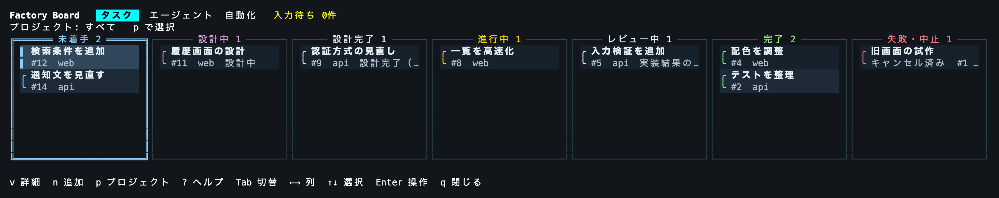

# Factory Board

Herdr TUI で作業をカードにして Codex または Claude Code に渡すプラグインです。手動タスクはタスクボードで、定期実行は自動化タブの履歴ボードで追跡し、終了後に担当エージェントの最終メッセージを読めます。

## ドキュメント

- [セットアップと起動](docs/getting-started.md)
- [ボードの操作とカードの実行](docs/board.md)
- [定期実行](docs/automation.md)
- [開発環境とコードの構成](docs/development.md)

## ライセンス

[MIT License](LICENSE)
