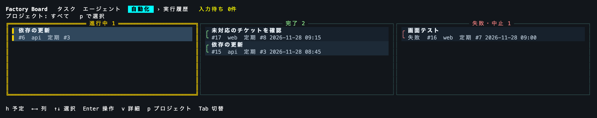

# 定期実行を設定する

タスクタブで `Shift+Tab` を1回押すと、自動化タブが開きます。ここで予定を登録し、`h` で実行履歴に切り替えます。

## 予定を登録する

| 実行方法 | 予定一覧で押すキー | 時刻・間隔欄の入力例 |
| --- | --- | --- |
| 一定の間隔で実行する | `i` | `15m`（15分おき） |
| 毎日決まった時刻に実行する | `n` | `09:00`（毎朝9時） |

1. 予定一覧で実行方法に合ったキーを押します。登録先は表示中のプロジェクトです。「すべて」で候補が複数ある場合はプロジェクトを選びます。候補が1件ならフォームが、初回はフォルダ選択が開きます。
2. 時刻または間隔を入力し、`Tab` で「実行内容」に移ります。`Enter` で改行でき、複数行の貼り付けもできます。macOS では `Ctrl+R` または「音声入力」で日本語を入力できます。[音声入力の操作](board.md#フォームで音声入力するmacos)
3. 必要に応じて `Ctrl+G` でこの予定の担当を Codex または Claude Code に切り替えます。新規タスクと予定の既定の担当は、一覧の `Ctrl+G` で設定できます。
4. `Ctrl+S` または「保存」で登録します。`Esc` で入力を取り消せます。登録後は一覧で予定を選び、`Enter` で時刻・間隔、作業先、実行内容を確認できます。`Esc` で一覧に戻ります。

登録すると、同じワークスペースに **Factory Board Scheduler** タブが開きます。Herdr サーバーとこのタブが動いていれば、ボードを閉じても定期実行は続きます。予定一覧には、選択中のプロジェクトの予定とワークスペース全体のスケジューラーの稼働状態が表示されます。`p` で「すべて」を選ぶと全プロジェクトの予定を確認できます。

## 次回の実行時刻

- **間隔指定**は1分単位です。たとえば `every 15m 未対応のタスクを確認する` を 10:07 に登録すると、初回は 10:22、次回は 10:37 が実行予定です。スリープや停止で複数回分を過ぎると、復帰時に直近の1回分を実行し、元の周期で続けます。
- **毎日の時刻指定**は実行マシンのローカル時刻を使います。登録時にその日の指定時刻を過ぎていれば翌日から開始します。スリープや停止から復帰したときは、当日の指定時刻を過ぎていれば当日分を一度だけ実行します。過去の日付の分は繰り越しません。

スケジューラーは約10秒ごとに時刻を確認します。

## 実行履歴を見る

自動化タブで `h` を押すと、予定一覧と履歴ボードを切り替えられます。実行ごとにカードが作成され、「進行中」「完了」「失敗・中止」の各列に新しい順に並びます。「進行中」には起動待ち・起動中のカードも含まれます。

左右キーで列、上下キーでカードを選びます。`Enter` で実行中の担当ペインや終了後の結果を開きます。`v` で詳細を開き、`Esc` で履歴に戻ります。`p` で作業先を絞り込めます。

## 登録済みの予定を変更する

| 変更したい項目 | 操作 |
| --- | --- |
| 実行内容を含む設定 | 予定一覧で `Enter` → `e`。実行内容欄から編集を始め、`Tab`・`Shift+Tab` で項目を移動し、`Ctrl+G` で担当を切り替えます。`Ctrl+S` または「保存」で確定します。 |
| 担当だけ | 予定一覧で `Enter` → `g`。その予定の担当を切り替えます。 |
| 時刻・間隔だけ | 予定一覧で `Enter`、または実行履歴のカードで `v` を押して詳細を開き、`t` を押します。間隔なら `1m` を `15m` に、毎日の時刻なら `09:00` を `10:30` に書き換え、`Enter` で保存します。 |

履歴のカードから変更する場合は、詳細の先頭で元の予定番号と現在の設定を確認できます。変更は次に作成されるカードから反映されます。時刻・間隔だけを変えた場合、予定番号・作業先・実行内容・実行履歴を引き継ぎます。

編集は `Esc` で取り消せます。時刻・間隔の編集では保存後も取消後も同じ詳細画面に戻ります。編集中の設定を別ペインから変更した場合は、保存時にフォームや時刻・間隔の入力欄に最新の設定が表示されます。内容を確認し、変更したい値を入力し直して保存してください。

- 間隔を変更すると、保存から新しい間隔が経過した時点が次の実行予定です。同じ間隔で保存すると、当初の次回予定を維持します。
- 毎日の予定は、当日分をすでに処理した場合や新しい時刻を過ぎている場合、翌日から新しい時刻を使います。

## スケジューラーの再開と予定の解除

スケジューラーのタブを閉じると、ワークスペースの定期実行が停止します。再開するにはボードで `scheduler` と入力します。予定の保存後に起動に失敗した場合も同じコマンドを使います。エラーには保存済みの予定番号が表示されるので、再登録せずに起動を再試行できます。旧版から切り替える場合は[更新手順](getting-started.md#旧版から更新する)を確認してください。

予定を解除するには、予定一覧で対象を選び、`x` → `Enter` で確定します。`Esc` で取り消せます。`remove 定期番号` でも解除できます。実行済みのカードは履歴に残ります。
